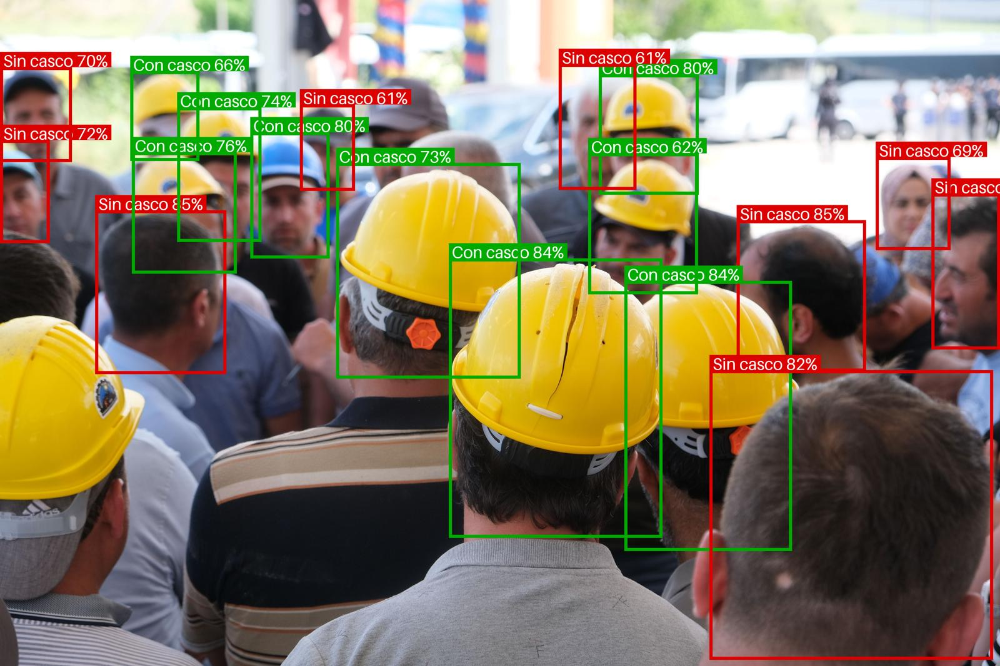

# Detector de EPP · Casco

App web que analiza fotos de obras en construcción y marca qué personas usan **casco** y cuáles no, con el **porcentaje de cumplimiento**.

Laboratorio Práctico Obligatorio · Técnicas de Procesamiento Digital de Imágenes · IFTS N.º 24 · 2026

**Autor:** José J. Navas A.

### 👉 [Probar la app en línea](https://huggingface.co/spaces/jose-navas-ai/detector-epp)

La versión en línea ejecuta el modelo **en el navegador**: la foto no se envía a ningún servidor.



## El problema

El encargado de Seguridad e Higiene de una constructora tiene que verificar que el personal use casco en varias obras. Hoy lo hace en persona o revisando fotos a ojo: es lento y no deja un registro ordenado.

Con esta app, el encargado sube la foto que sacó con el celular durante la recorrida y obtiene:

1. La foto con recuadros: **verde** para con casco y **rojo** para sin casco.
2. Un resumen con las **cabezas** detectadas, cuántas tienen casco y cuántas no, y el % de cumplimiento.

## Cómo funciona

| Pieza | Qué se usó |
|---|---|
| Tarea | **Detección de objetos**: para cada objeto, el modelo devuelve dónde está (una caja), qué es (una clase) y con qué confianza |
| Modelos | **Preciso** (por defecto): [luisarizmendi/hardhat-or-hat](https://huggingface.co/luisarizmendi/hardhat-or-hat) v1 (YOLO11x, 114 MB), con las clases `helmet` y `no_helmet`. **Rápido**: [keremberke/yolov8n-hard-hat-detection](https://huggingface.co/keremberke/yolov8n-hard-hat-detection) (YOLOv8 nano, 6 MB), con las clases `Hardhat` y `NO-Hardhat` |
| Librerías | [Ultralytics](https://docs.ultralytics.com/) para el modelo y [Gradio](https://www.gradio.app/) para la interfaz web |
| Lógica propia | Cuenta cabezas con y sin casco, calcula el cumplimiento y dibuja las cajas (`app.py`, secciones 3 y 4) |

El modelo detecta **cabezas, no personas**. Esa es la categoría que definieron quienes etiquetaron el dataset de entrenamiento.

## Instalación

Requisitos: [uv](https://docs.astral.sh/uv/) y Python 3.12.

```bash
git clone <url-del-repositorio>
cd detector-epp
uv venv --python 3.12
uv pip install -r requirements.txt
```

Para usar también el cuaderno `playground.ipynb`, instalá `requirements-dev.txt` en lugar de `requirements.txt`.

## Uso

```bash
# Windows
.venv\Scripts\python app.py
# macOS / Linux
.venv/bin/python app.py
```

Abrí `http://127.0.0.1:7860` en el navegador, subí una foto y tocá **Analizar**. La primera vez se descargan los pesos de los dos modelos (120 MB en total).

La app permite ajustar tres parámetros:

| Parámetro | Valor inicial | Para qué sirve |
|---|---|---|
| Modelo | Preciso | Preciso distingue gorras y cabezas descubiertas de los cascos. Rápido es más liviano, pero las confunde con cascos |
| Umbral de confianza | 0,25 | Más bajo: encuentra más cabezas, pero con más errores |
| Tamaño de análisis | 640 con Preciso, combinado con Rápido | YOLO achica la foto a este tamaño antes de analizarla. 1280 detecta personas lejanas; combinado usa 640 y 1280. Al cambiar de modelo se elige el tamaño que mejor le funcionó en las pruebas |

> **Usuarios de Windows con antivirus Avast:** si Python se cierra con `OPENSSL_Uplink ... no OPENSSL_Applink`, el problema es la variable `SSLKEYLOGFILE`. La app ya la borra al iniciar. Ver [PLAN.md](PLAN.md), problema 2.

## Versión web (Hugging Face Spaces)

Hugging Face cobra la suscripción PRO para alojar apps de Gradio, pero los Spaces **estáticos** (páginas HTML) son gratuitos. Por eso la versión en línea es una página aparte, [web/index.html](web/index.html), que repite la lógica de `app.py` en JavaScript:

1. `exportar_onnx.py` convierte los modelos al formato **ONNX**. El modelo Preciso pesa 228 MB en ONNX, así que se **comprime a int8** (cada peso ocupa 1 byte en lugar de 4) y queda en 58 MB (`web/modelo_preciso.onnx`). El Rápido queda en 13 MB (`web/modelo.onnx`).
2. La página los ejecuta con [ONNX Runtime Web](https://onnxruntime.ai/), achica la foto igual que YOLO, elimina las cajas repetidas (NMS) y calcula el cumplimiento.
3. `publicar_space.py` sube la carpeta `web/` y la ficha `hf_space/README.md` al Space.

Diferencias con `app.py`:
- **El modelo Preciso comprimido es algo menos exacto:** error total 15 en lugar de 11 en las 17 fotos. Por ejemplo, en la foto del pañuelo no detecta al hombre de anteojos sin casco.
- **Es más lento:** cada análisis con el modelo Preciso tarda unos 7 a 9 segundos en el navegador.
- Puede haber diferencias mínimas en detecciones cercanas al umbral, porque el navegador achica la imagen con otro método.
- Solo la versión web permite **corregir a mano** las cajas.

Para probarla en la computadora: `python -m http.server --directory web` y abrir `http://localhost:8000`.

## Estructura del proyecto

| Archivo | Contenido |
|---|---|
| `app.py` | La aplicación: modelo, lógica de conteo e interfaz |
| `evaluar.py` | Analiza todas las fotos de `pruebas/` y arma la tabla de resultados |
| `playground.ipynb` | Cuaderno de exploración paso a paso |
| `pruebas/` | Fotos de prueba, sus fuentes (`fuentes.md`) y los resultados marcados |
| `web/` | Versión web: página, modelo ONNX y fotos de ejemplo |
| `exportar_onnx.py` | Convierte los modelos a ONNX (y comprime el Preciso) para la versión web |
| `publicar_space.py` y `hf_space/` | Publican la versión web en Hugging Face Spaces |
| `PLAN.md` | Plan del proyecto, decisiones y registro de problemas |

## Resultados de las pruebas

Se probaron **17 fotos** de Pexels que cubren distintos casos: de frente, de espaldas, a contraluz, en blanco y negro, personas lejanas, multitudes, gorras y un casco en la mano. El detalle de cada foto está en [pruebas/fuentes.md](pruebas/fuentes.md).

| Modelo y tamaño | Fotos con conteo exacto | Error total del conteo | Multitud con gorras (real ≈ 47 %) |
|---|:---:|:---:|:---:|
| Rápido, 640 | 8 de 17 | 29 | 88 % |
| Rápido, 1280 | 8 de 17 | 26 | 86 % |
| Rápido, combinado | 10 de 17 | 24 | 82 % |
| **Preciso, 640** (por defecto) | **10 de 17** | **11** | **50 %** |
| Preciso comprimido (versión web) | 10 de 17 | 15 | 53 % |

El "error total" suma, foto por foto, cuántas cabezas con casco y sin casco de diferencia hay con la realidad.

**Qué mejoró con el modelo Preciso:** reconoce gorras, pañuelos y cabezas descubiertas como "sin casco" y no cuenta el casco que se lleva en la mano. Con él, el cumplimiento se acerca mucho al real.

**Funciona bien** con pocas personas y cascos visibles: de frente, de perfil, de espaldas, a contraluz, en blanco y negro y con cascos de cualquier color.

**Sigue fallando** con:

| Caso | Ejemplo |
|---|---|
| Cascos tapados por otras cabezas, en multitudes | Detecta 4 de 8 cascos en una foto con cascos superpuestos |
| Personas agachadas o cascos vistos desde arriba | No los detecta |

## Límites conocidos

- **El modelo puede equivocarse.** Por eso la app avisa que hay que revisar la foto y, en la **versión web**, se puede **tocar una caja para corregirla** (con casco → sin casco → descartada). El cumplimiento se recalcula y las cajas corregidas se marcan con ✎.
- **El modelo Preciso es pesado:** 114 MB, unos 2 segundos por foto en una PC sin placa de video y 7 a 9 segundos en el navegador. El modelo Rápido queda como alternativa.
- **Datos de prueba:** se usaron 17 fotos de bancos libres (Pexels), no fotos reales de obras argentinas. Con tan pocas fotos, las diferencias entre configuraciones son orientativas.
- **Modelos de terceros sin auditoría independiente:** las precisiones declaradas en sus fichas las midieron sus autores, y la ficha del modelo Preciso tiene datos inconsistentes (PLAN.md, sección 3 bis).

## Trabajo futuro

- **Reentrenar con fotos de obras locales**, con más ejemplos de cascos tapados y personas agachadas. Las correcciones manuales de la versión web podrían guardarse para usarlas como datos de entrenamiento.
- Detectar chalecos reflectivos.
- Generar un registro descargable (CSV) con fecha, obra y resultado.
- Analizar video o la webcam en vivo.

## Licencias y créditos

- **Ultralytics YOLO** se distribuye con licencia AGPL-3.0. Para ofrecer la app como servicio comercial hay que publicar el código o adquirir una licencia de Ultralytics.
- **Modelos:** luisarizmendi (Preciso) y keremberke (Rápido) en Hugging Face. Ninguna de las dos fichas declara licencia.
- **Fotos de prueba:** [Pexels](https://www.pexels.com/), con licencia libre. Los links de cada foto están en [pruebas/fuentes.md](pruebas/fuentes.md).
