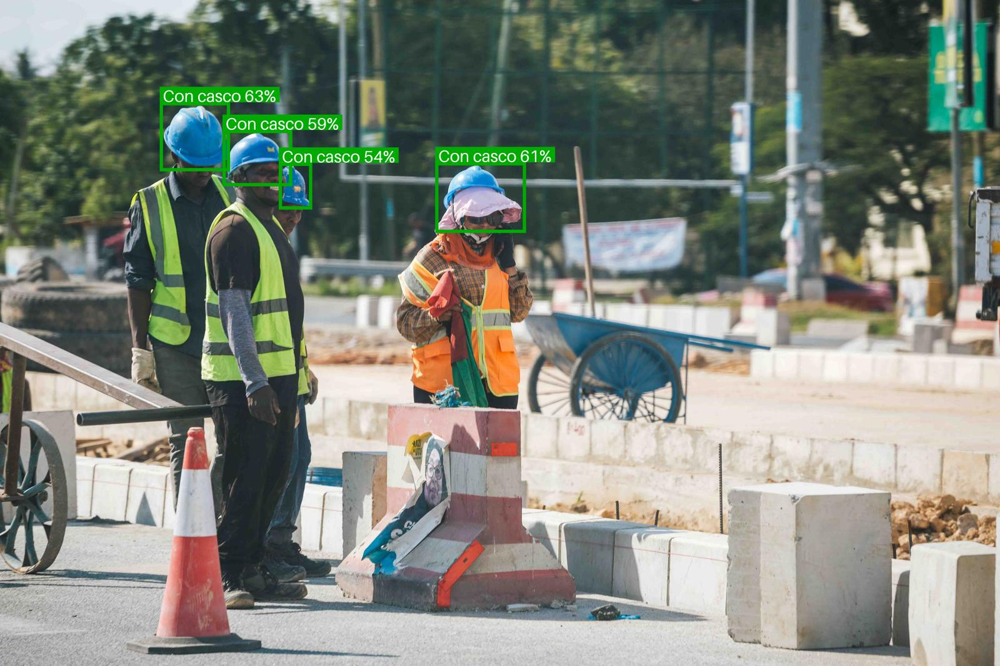

# Detector de EPP · Casco

App web que analiza fotos de obras en construcción y marca qué personas usan **casco** y cuáles no, con el **porcentaje de cumplimiento**.

Laboratorio Práctico Obligatorio · Técnicas de Procesamiento Digital de Imágenes · IFTS N.º 24 · 2026

**Autor:** José J. Navas A.

### 👉 [Probar la app en línea](https://huggingface.co/spaces/jose-navas-ai/detector-epp)

La versión en línea ejecuta el modelo **en el navegador**: la foto no se envía a ningún servidor.



## El problema

El encargado de Seguridad e Higiene de una constructora tiene que verificar que el personal use casco en varias obras. Hoy lo hace en persona o revisando fotos a ojo: es lento y no deja un registro ordenado.

Con esta app, el encargado sube la foto que sacó con el celular durante la recorrida y obtiene:

1. La foto con recuadros: **verde** para con casco y **rojo** para sin casco.
2. Un resumen con las **cabezas** detectadas, cuántas tienen casco y cuántas no, y el % de cumplimiento.

## Cómo funciona

| Pieza | Qué se usó |
|---|---|
| Tarea | **Detección de objetos**: para cada objeto, el modelo devuelve dónde está (una caja), qué es (una clase) y con qué confianza |
| Modelo | [keremberke/yolov8n-hard-hat-detection](https://huggingface.co/keremberke/yolov8n-hard-hat-detection) (YOLOv8 nano, 6 MB), con las clases `Hardhat` y `NO-Hardhat` |
| Librerías | [Ultralytics](https://docs.ultralytics.com/) para el modelo y [Gradio](https://www.gradio.app/) para la interfaz web |
| Lógica propia | Cuenta cabezas con y sin casco, calcula el cumplimiento y dibuja las cajas (`app.py`, secciones 3 y 4) |

El modelo detecta **cabezas, no personas**. Esa es la categoría que definieron quienes etiquetaron el dataset de entrenamiento.

## Instalación

Requisitos: [uv](https://docs.astral.sh/uv/) y Python 3.12.

```bash
git clone <url-del-repositorio>
cd detector-epp
uv venv --python 3.12
uv pip install -r requirements.txt
```

Para usar también el cuaderno `playground.ipynb`, instalá `requirements-dev.txt` en lugar de `requirements.txt`.

## Uso

```bash
# Windows
.venv\Scripts\python app.py
# macOS / Linux
.venv/bin/python app.py
```

Abrí `http://127.0.0.1:7860` en el navegador, subí una foto y tocá **Analizar**. La primera vez se descargan los pesos del modelo (6 MB).

La app permite ajustar dos parámetros:

| Parámetro | Valor inicial | Para qué sirve |
|---|---|---|
| Umbral de confianza | 0,25 | Más bajo: encuentra más cabezas, pero con más errores |
| Tamaño de análisis | Combinado | YOLO achica la foto a este tamaño antes de analizarla. 1280 detecta personas lejanas; 640 es más rápido; combinado usa los dos y es el más preciso |

> **Usuarios de Windows con antivirus Avast:** si Python se cierra con `OPENSSL_Uplink ... no OPENSSL_Applink`, el problema es la variable `SSLKEYLOGFILE`. La app ya la borra al iniciar. Ver [PLAN.md](PLAN.md), problema 2.

## Versión web (Hugging Face Spaces)

Hugging Face cobra la suscripción PRO para alojar apps de Gradio, pero los Spaces **estáticos** (páginas HTML) son gratuitos. Por eso la versión en línea es una página aparte, [web/index.html](web/index.html), que repite la lógica de `app.py` en JavaScript:

1. `exportar_onnx.py` convierte el modelo al formato **ONNX** (`web/modelo.onnx`).
2. La página lo ejecuta con [ONNX Runtime Web](https://onnxruntime.ai/), achica la foto igual que YOLO, elimina las cajas repetidas (NMS) y calcula el cumplimiento.
3. `publicar_space.py` sube la carpeta `web/` y la ficha `hf_space/README.md` al Space.

Los resultados coinciden con los de `app.py`. Puede haber diferencias mínimas en detecciones cercanas al umbral, porque el navegador achica la imagen con otro método.

Para probarla en la computadora: `python -m http.server --directory web` y abrir `http://localhost:8000`.

## Estructura del proyecto

| Archivo | Contenido |
|---|---|
| `app.py` | La aplicación: modelo, lógica de conteo e interfaz |
| `evaluar.py` | Analiza todas las fotos de `pruebas/` y arma la tabla de resultados |
| `playground.ipynb` | Cuaderno de exploración paso a paso |
| `pruebas/` | Fotos de prueba, sus fuentes (`fuentes.md`) y los resultados marcados |
| `web/` | Versión web: página, modelo ONNX y fotos de ejemplo |
| `exportar_onnx.py` | Convierte el modelo a ONNX para la versión web |
| `publicar_space.py` y `hf_space/` | Publican la versión web en Hugging Face Spaces |
| `PLAN.md` | Plan del proyecto, decisiones y registro de problemas |

## Resultados de las pruebas

Se probaron **17 fotos** de Pexels que cubren distintos casos: de frente, de espaldas, a contraluz, en blanco y negro, personas lejanas, multitudes, gorras y un casco en la mano. El detalle de cada foto está en [pruebas/fuentes.md](pruebas/fuentes.md).

| | `imgsz=640` | `imgsz=1280` | **Combinado** (por defecto) |
|---|:---:|:---:|:---:|
| Fotos con conteo exacto | 8 de 17 | 8 de 17 | **10 de 17** |
| Error total del conteo | 29 | 26 | **24** |

El modo **combinado** analiza la foto con 640 y con 1280, une las detecciones y elimina las cajas repetidas sobre la misma cabeza.

**Funciona bien** con pocas personas y cascos visibles: de frente, de perfil, de espaldas, a contraluz, en blanco y negro y con cascos de cualquier color.

**Falla** en estos casos:

| Caso | Ejemplo |
|---|---|
| Gorras, pañuelos y cabezas descubiertas marcadas como "con casco" | En una multitud informa 88 % de cumplimiento cuando el real es menor a 50 % |
| Cascos tapados, cascos vistos desde arriba y personas agachadas | No los detecta |
| Casco en la mano | Lo cuenta como "con casco": el modelo detecta el objeto, no si la persona lo tiene puesto |

## Límites conocidos

- **El cumplimiento sale más alto que el real.** El modelo casi nunca usa la clase "sin casco": confunde gorras, pañuelos y cabezas descubiertas con cascos. Estos errores son del modelo: ninguna regla de posprocesamiento que se probó los separa de los cascos reales. Por eso:
  - la app avisa que hay que revisar la foto;
  - en la **versión web** se puede **tocar una caja para corregirla** (con casco → sin casco → descartada) y el cumplimiento se recalcula. Las cajas corregidas se marcan con ✎.
- **Analizar dos veces es más lento:** el modo combinado tarda el doble. Si hace falta velocidad, se puede elegir 640.
- **Datos de prueba:** se usaron fotos de bancos libres (Pexels), no fotos reales de obras argentinas.
- **Modelo chico y sin mantenimiento:** es la versión *nano* de YOLOv8 y se publicó hace más de 3 años. Su precisión declarada (mAP50 = 0,836) la midió el propio autor.

## Trabajo futuro

- **Cambiar o reentrenar el modelo:** es la única forma de corregir de raíz las gorras, los pañuelos y el casco en la mano. Primero hay que probar el modelo 2 del plan (`luisarizmendi/hardhat-or-hat`), que tiene la clase "gorra". Después, reentrenar con fotos de obras locales y más ejemplos de cabezas sin casco. Las correcciones manuales de la versión web podrían guardarse para usarlas como datos de entrenamiento.
- Detectar chalecos reflectivos.
- Generar un registro descargable (CSV) con fecha, obra y resultado.
- Analizar video o la webcam en vivo.

## Licencias y créditos

- **Ultralytics YOLO** se distribuye con licencia AGPL-3.0. Para ofrecer la app como servicio comercial hay que publicar el código o adquirir una licencia de Ultralytics.
- **Modelo:** keremberke en Hugging Face. La ficha no declara licencia.
- **Fotos de prueba:** [Pexels](https://www.pexels.com/), con licencia libre. Los links de cada foto están en [pruebas/fuentes.md](pruebas/fuentes.md).
